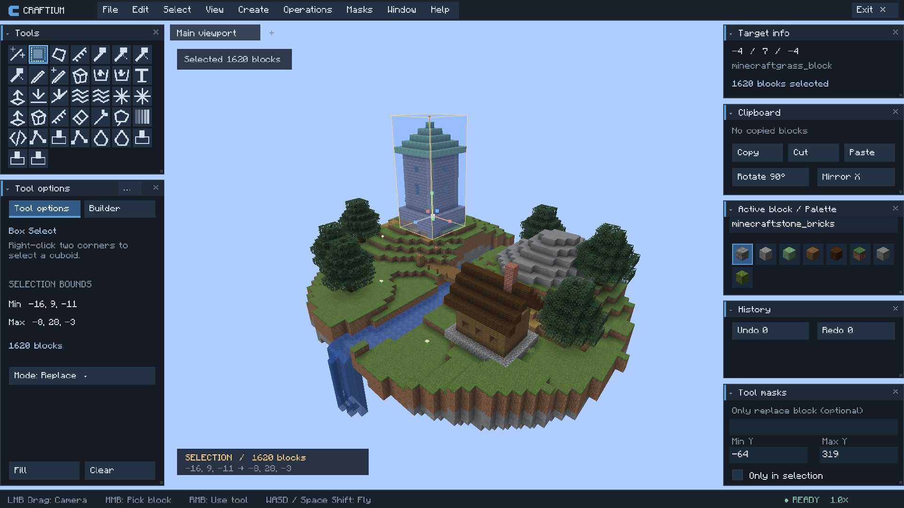
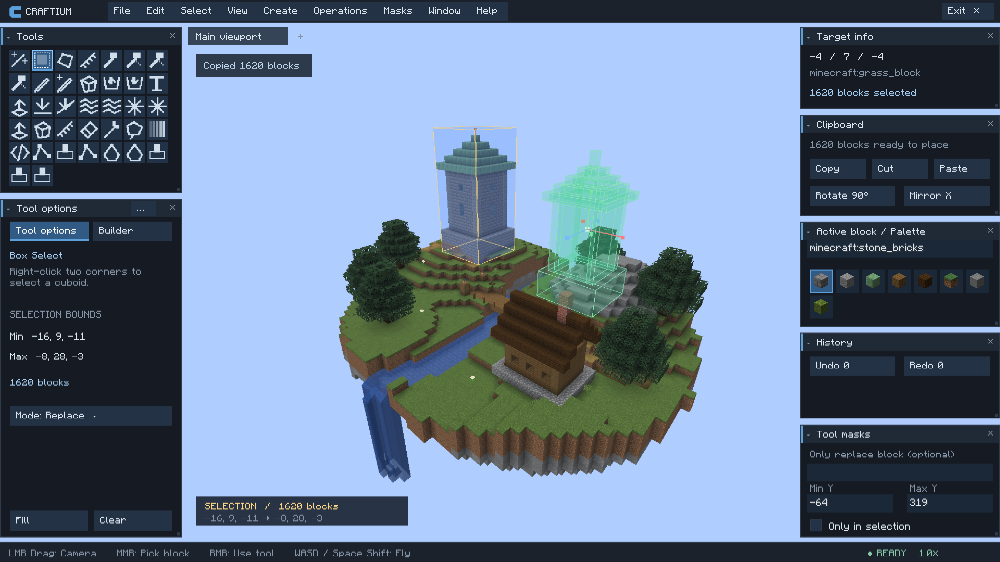
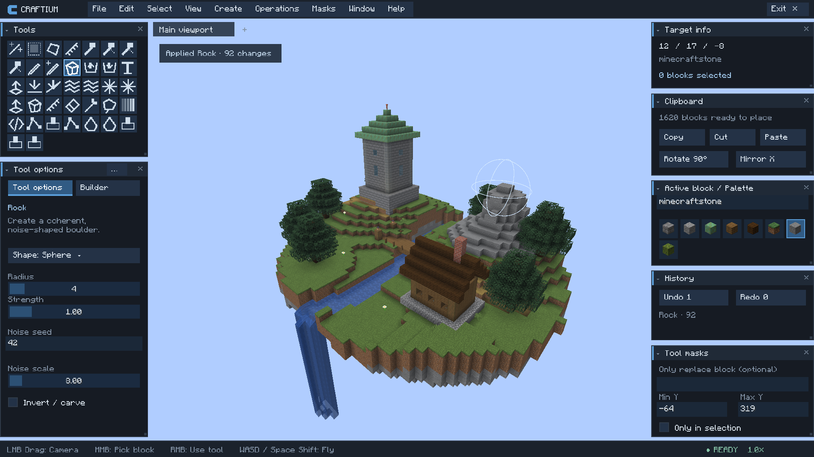
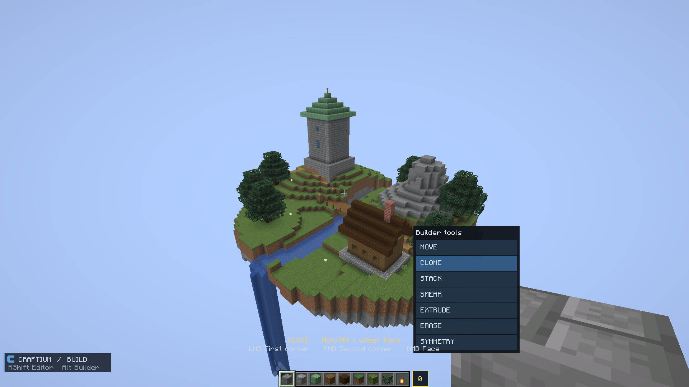
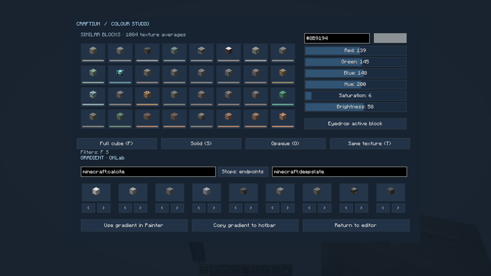
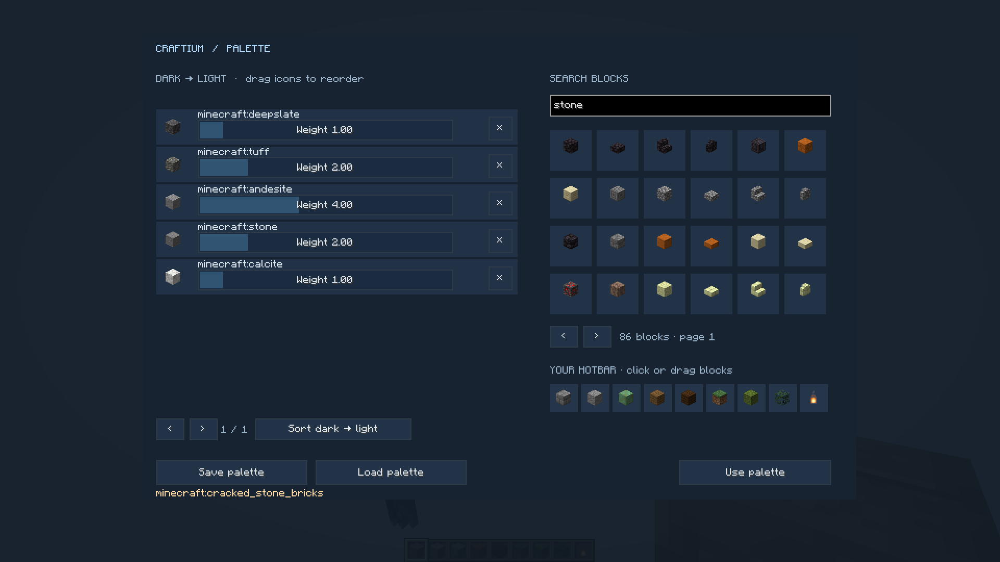
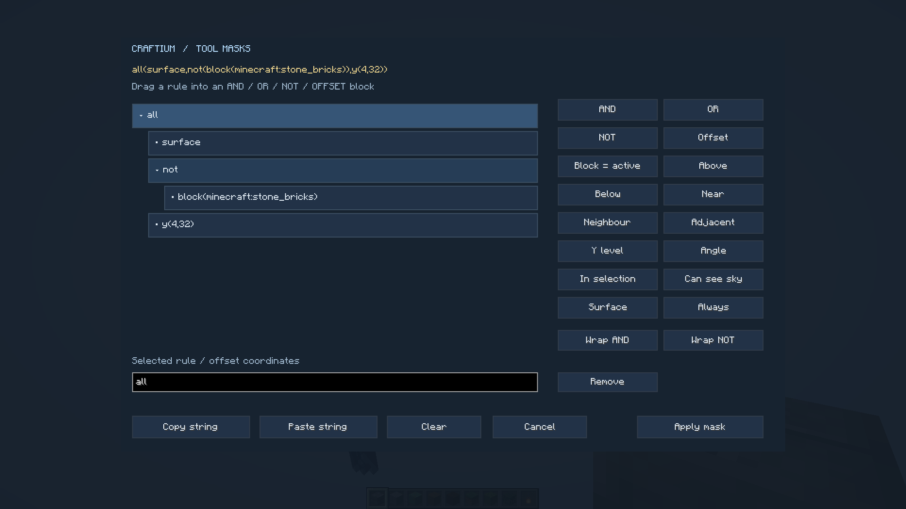
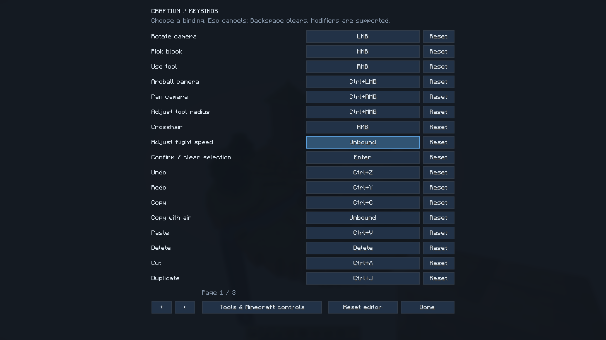

# Craftium gallery

Actual Craftium 0.3.1-dev screenshots from Minecraft Java 26.2, captured at 1920 × 1080. The sample world is original, with no image retouching or added text.

## Editor workspace

Select and transform structures with the toolbar, gizmos, clipboard and palette in one workspace.

## Clipboard placement

Preview a copied watchtower before placing it in the world.

## Rock and terrain tools

The Rock tool with a live brush outline, radius controls and undo history.

## In-game builder tools

Access Move, Clone, Stack, Smear, Extrude, Erase and Symmetry from the tenth hotbar slot.

## Colour Studio

Match colours to block textures and create gradients between chosen materials.

## Weighted palettes

Build a material palette, adjust weights and search available blocks.

## Visual masks

Combine surface, block and height rules to control which blocks a tool can change.

## Configurable controls

Edit shortcuts and mouse gestures, with Axiom's documented defaults.

